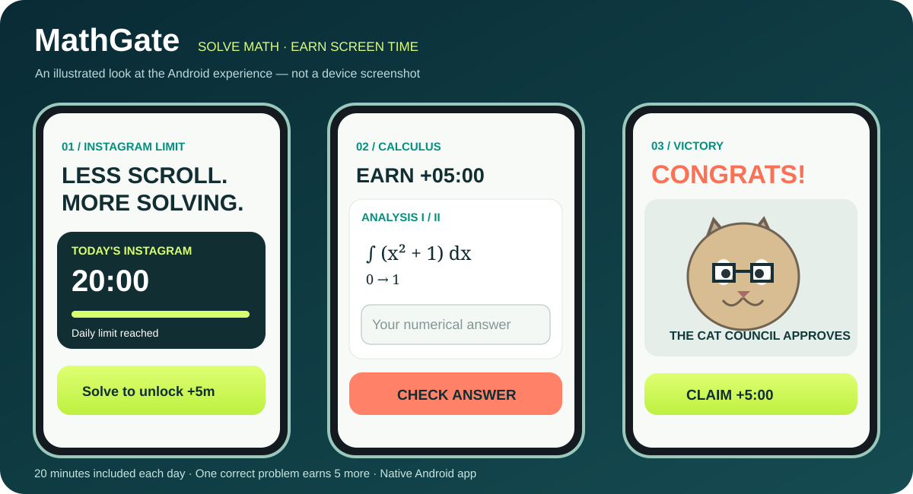

# MathGate 🧠🔒

*Illustrative product preview (not a photograph or an app-store screenshot).*

**Instagram: 20 minutes daily, then +5 minutes for every solved university-level calculus problem.**

MathGate is a free, public-source Android app. It uses a light graphite, electric lime, and teal interface, and an offline mathematical equation display.

## What's in version 0.9.4? — More accurate Instagram foreground time

**Fixed two actual usage-accounting bugs:**
- Android **KEYGUARD_SHOWN** is event **17** (phone locked), not 18. Event 18 means the keyguard was *hidden* (phone unlocked). The old code could incorrectly stop counting Instagram when the user unlocked the screen.
- Android reports resume/pause events per **Activity**, not per entire app. When Instagram transitions from its feed to Reels, a delayed pause from the feed must not terminate a session if Reels is already resumed. MathGate now tracks the active Activity class and ignores the stale pause.

The 20-minute daily base and +5 minutes per solved challenge are unchanged. The midnight clipping fix from v0.9.3 also remains.

**Inspect discrepancies on your Samsung:** MathGate's dashboard now includes **VERIFY INSTAGRAM USAGE**, with two controls:
- **Check counted time with a short Instagram visit:** record an initial counter, browse Instagram for roughly one minute, return to MathGate and compare the elapsed wall time with the foreground duration MathGate measured. This does not award minutes, change the limit or bypass the math challenge. It is disabled if you are already locked out.
- **Compare Android usage sources:** show MathGate's event-derived counter alongside Android's aggregate daily UsageStats value. The aggregate is **diagnostic only** because Android may widen its interval and include neighboring time periods. Neither value is Samsung's private Digital Wellbeing counter.

If Samsung's Digital Wellbeing timer still differs, take a screenshot of that timer and MathGate's comparison panel at nearly the same moment. The standard Android APIs cannot retrieve Samsung's private timer directly, and Activity class names are not unique identifiers for every Android Activity instance. A small disagreement may remain.

Tests now cover the Android keyguard event IDs, unlocking/locking, Feed-to-Reels transitions, delayed Activity pauses, and switching to another app. CI checks that Activity class information actually reaches the calculator.

## Previous version 0.9.3 — Midnight reset repair

**Fixes previous-day Instagram usage surviving local midnight.** MathGate v0.9.2 combined timestamped foreground events with pre-aggregated Android daily usage buckets. Android documents that its daily usage query may expand the requested range to whole interval periods. Taking the maximum could therefore carry yesterday's usage into today.

Version 0.9.3 **removes the daily aggregate entirely** and calculates today's Instagram usage only from timestamped foreground events, clipped to **today's local midnight**. It looks back to the previous local midnight (not a fixed 24 hours) to recognize sessions crossing midnight, including DST transitions. Yesterday's Instagram time no longer consumes today's allowance; if Instagram remains open across midnight, only the post-midnight portion counts.

The app dashboard now displays the current local calendar day and refreshes automatically after midnight while open. The Accessibility guard's foreground recovery also looks back across midnight. Earned five-minute bonuses and pending rewards reset at local day change; completed-question history remains saved.

**Quick verification:** At 00:01, open MathGate. The new day's usage should start at **0:00** if Instagram wasn't used after midnight, or show only the minutes since midnight if Instagram stayed open. Available allowance returns to 20 minutes before additional earned rewards. Samsung Digital Wellbeing may still use a slightly different accounting method.

Ten JVM regression tests cover yesterday carryover, midnight-spanning usage, local DST days, screen locking, and foreground recovery. A successful build does not replace a Samsung device test.

## Previous version 0.9.2 — Android blocking reliability

**Important reliability fix:** Previous versions could stop watching Instagram after a window-state event and attempted to launch a challenge Activity directly from an Android background service. On recent Samsung/Android firmware, background Activity launches may be ignored without an exception. This could leave Instagram open long past the 20-minute daily allowance.

Version 0.9.2 uses a **full-screen Accessibility overlay** to cover Instagram when the allowance expires. It prevents interacting with the Instagram screen and offers a button to open MathGate's calculus challenge via a user-initiated tap. It also recovers the foreground app from Android system usage events, compares reconstructed usage against Android's daily aggregate, and blocks when Usage Access is missing. If drawing an overlay fails, it attempts to navigate HOME instead of silently permitting Instagram. These are best-effort system APIs, not device-owner guarantees.

**Check protection immediately:** Open MathGate and use **TEST LOCK NOW · no need to wait 20 min**. This opens Instagram and demands a 90-second temporary overlay. You should see a MathGate test screen within a few seconds, without using up or granting any extra minutes. Return to MathGate: the dashboard reports the service heartbeat, last Instagram detection, last successful block, and last error/action. A green Android permission switch alone is *not* treated as proof the background monitor is responding.

**If the test fails:** check MathGate's Accessibility and Usage Access settings. Disable and re-enable **MathGate Instagram Guard** in Settings → Accessibility → Installed apps. On Samsung, you can also review **Settings → Apps → MathGate → Battery**, and consider **Unrestricted** if the system is suspending the service. If its heartbeat is still stale or it never detects Instagram, the guard is not verified on this device.

An Accessibility-based app still cannot make itself impossible to disable: the user or OS can revoke permission, force-stop, uninstall or otherwise prevent it from running. This feature is not a substitute for a device-owner policy or Samsung's native app timer when enforcement must be guaranteed.

## Previous version 0.9.1

**Correct Samsung installation order:** The first-run wizard now follows **Accessibility (attempt/trigger warning) → MathGate App info (⋮ Allow restricted settings) → Accessibility again (enable)**, after Usage Access. This fixes the missing three-dot menu on Samsung firmware that only exposes the option after the first blocked Accessibility attempt. Only actual Android permission states determine completion. No Instagram timer or equation-bank rules changed.

## Previous version 0.9.0

**No repeated unlock questions until you've completed the pool.** MathGate now records the ID of every successfully claimed mathematical problem, separately for Foundation, Standard and Advanced, and keeps a question from reappearing until the entire 18-question pool at that difficulty has been solved. It also prefers a different subject family—standard integrals, residue theorem, PDE, etc.—from the previous solution whenever possible. At a cycle boundary, the last solved problem is still excluded if another is available.

**Unsolved problems stay fixed.** Closing the app, returning from Instagram, refreshing the preview, or getting the answer wrong will *not* replace the active lock challenge. Only successfully solving **and claiming** +5:00 completes the problem. History is stored locally across app restarts and local days. Uninstalling the app clears local history. Downloading a larger owner-signed question library adds new choices without disabling the protection.

The implementation is covered by JUnit tests for no repeats within a cycle, topic variety, cycle rollover, limited question banks and input validation.

## Previous version 0.8.0

**Android first-install setup wizard:** If Usage Access or Accessibility permission isn't enabled, MathGate now opens a guided, progress-checked, three-step setup screen. Step 1 opens Android Usage Access; step 2 opens **MathGate App info** with explicit instructions for Samsung's hidden **⋮ → Allow restricted settings** control; step 3 opens Accessibility settings. The wizard verifies both actual Android permissions and only marks protection ready when both are enabled. The main dashboard has a **View permission setup checklist** link.

**iPhone project:** a preliminary iOS app and Device Activity Monitor extension are now included under [ios/](ios/). These are **source code only**, not an installable iPhone app. iOS deployment requires Apple's Family Controls distribution entitlement, Apple Developer signing, physical-device testing and TestFlight/App Store distribution. See [ios/README.md](ios/README.md). Do not download the Android APK on iPhone.

**Real Android layout repair:** the Victory screen now fits the cat meme at its full original aspect ratio, without a 255dp crop. Claim +5:00 and Leave are in a fixed bottom area above the Samsung navigation bar, including Android 15/16 system-bar insets.

**In-app application updater:** press **Update MathGate directly from GitHub**. The app checks the official latest Release, downloads its APK over HTTPS, validates size and GitHub's SHA-256 digest, confirms the package name and that the signing certificate matches your currently installed version, then launches the Android system installer. You still approve installation and may need to allow MathGate as an installation source once. No downloaded update can execute code without Android's installation approval.

**One-time prerequisite:** v0.6.0 uses a temporary CI debug certificate. Android cannot update it in place using a different signing certificate. The new permanent release identity requires one initial uninstall/install transition from v0.6.0 to the first stable-signed v0.7.0 release. After that, future versions signed by the same owner-controlled identity can install without uninstalling MathGate. See [UPDATING.md](UPDATING.md).

**Security hardening:** GitHub-hosted equations and cat memes now require an **owner-signed ECDSA P-256 manifest and matching SHA-256 hashes**. An unsigned GitHub edit is rejected by the app. This protects installed users from unauthorized content edits after they have installed v0.6. See [SECURITY.md](SECURITY.md) for the private-key owner workflow and GitHub branch-protection setup.

**New reward flow:** after submitting the correct answer, MathGate shows a *Congrats!* celebration, an AI-created cat illustration, a silly daily caption, and a **Claim +5:00 · Open Instagram** button. The five-minute allowance is awarded **only when that button is tapped**. Leaving the reward screen without claiming leaves a pending reward for the same day; it cannot be claimed twice. The daily Instagram time rule is unchanged.

The APK bundles **two compact AI-generated cat illustrations**, paired with **16 different AI-written meme captions**. A deterministic daily selection keeps the same joke for one local calendar day; the joke changes the next day. The cat-meme catalogue is a separate versioned file on GitHub and the in-app **Download AI cat memes from GitHub** button can update captions and download additional WebP pictures without reinstalling the app. The bundled offline memes are always available.

**AI-generation limitation:** the app does not run an image generator on the phone and does not generate a new image from scratch each morning. Daily generation of entirely new images would require an external image-generation provider and configured credentials; this has **not** been enabled. The current artwork was AI-generated in advance and rotates by day.

- **54 curated problems:** 18 Foundation, 18 Standard, 18 Advanced. The previous eight coefficient-randomized templates remain as emergency fallback.
- Topics include **Cauchy's formula and residue theorem** (simple, repeated and higher-order poles), **PDEs** (heat, wave, transport, Laplace, Poisson, inviscid Burgers), vector calculus, ODEs, integration, Fourier methods, optimization and series.
- **Good-looking math:** common TeX formulas are converted to offline MathML Core and displayed by Android WebView. No CDN or JavaScript is needed.
- **Difficulty selector** inside MathGate. Changing difficulty never resets Instagram usage.
- **Show another equation** in the practice-preview card displays a different randomly selected question at your chosen difficulty. The view includes a short prompt and a typeset equation, not the answer. It stays at your current scroll position.
- Preview refresh does **not** alter, skip, or regenerate the genuine challenge blocking Instagram. That challenge remains fixed until solved.
- **Typed numeric expressions:** 2*pi, sqrt(3)/2, exp(-1), 1/3, etc. MathGate does not evaluate full symbolic proofs.
- **Download new equations from GitHub** in the app; new questions do not require a new APK.
- **Check for MathGate app updates** through GitHub Releases. Android must still approve APK installation.

## Cat meme image refresh — revision 2 (no reinstall)

The two original 164-pixel cat pictures contained cut-off text inside the image itself. The signed GitHub meme pack now replaces them with wider clean cat images **without any embedded, cropped caption**. The daily silly message remains native app text below the image. To install the pictures in MathGate v0.6/v0.7, open the app and tap **Download AI cat memes from GitHub**. Check that it reports **revision 2**, then reopen the Victory screen. The installed APK and Instagram quota do not change.

## Meme catalogue and GitHub updates

The editable [cat meme catalogue](app/src/main/assets/cat_memes.json) contains entries with `id`, `image`, `title`, and `message`. To add a new picture, commit a WebP file named `cat_NN.webp` under [app/src/main/assets/memes](app/src/main/assets/memes) and reference its exact filename in the catalogue. Increment top-level `revision` and sign all affected assets using your private key before committing (see [SECURITY.md](SECURITY.md)). In the app, select **Download AI cat memes from GitHub** to retrieve the new data and images. Only the project's fixed GitHub path is accepted. Images are type-, dimensions-, and size-checked; no remote code is executed.

A meme is selected based on the local day and remains stable for that day, even if the catalogue is refreshed. The library currently contains **16 daily captions and 2 images**. To add a genuinely new AI-generated image every day automatically, a scheduled generation workflow and private provider credentials would be needed.

## Instagram rule

1. Get **20 minutes** of Instagram foreground usage per local calendar day.
2. Once exhausted, opening Instagram triggers a full-screen MathGate challenge.
3. One correct typed result brings up a celebratory reward screen. **Only tapping Claim +5:00 grants the five-minute extension**; the cat meme itself cannot be skipped to grant time.
4. Repeat whenever your earned minutes expire; there is no arbitrary maximum number of correct unlocks.
5. Bonus minutes persist across Instagram sessions today and reset at local midnight.
6. There are **no in-app skip, pause, quota-reset or disable controls**.

Time comes from Android's usage-event records (UsageStatsManager), not an app-specific stopwatch. Samsung Digital Wellbeing does not expose a public API to its exact displayed counter; small differences may occur.

## Samsung permission denied: correct Accessibility setup order

When MathGate is installed from an APK, Samsung may show **"App was denied access"** the first time you try enabling its Accessibility service. On some One UI builds, **the three-dot option only appears after that first blocked attempt**.

The in-app first-install wizard now follows the actual four-step Samsung sequence:

1. **Usage Access:** Open MathGate's Usage Access settings, find MathGate and enable **Permit usage access**.
2. **Accessibility — first attempt:** Open **Settings → Accessibility → Installed apps → MathGate Instagram Guard**. Tap the disabled entry / try turning it ON. If Samsung shows **App was denied access** (or Restricted setting), dismiss the warning and return to MathGate.
3. **App info — allow restricted settings:** Open **Settings → Apps → MathGate → ⋮ → Allow restricted settings**. Authenticate with PIN/fingerprint when prompted. The ⋮ menu can be missing until you've actually attempted step 2. If missing, return to step 2 and trigger the warning.
4. **Accessibility — second attempt:** Return to **Settings → Accessibility → Installed apps → MathGate Instagram Guard**, turn it **ON**, accept Android's sensitive-permission confirmation, then return to MathGate.

If Accessibility was enabled directly in step 2 without an error, **steps 3 and 4 are unnecessary**. On some Samsung/Android versions the restricted-settings option may appear differently or not be required.

MathGate can verify actual **Usage Access** and **Accessibility service enabled** states. Android does **not** expose a public read API for **Allow restricted settings**, so the app does not falsely mark that action complete merely because App info was opened. The wizard displays navigation milestones and reports success **only when both permissions are actually enabled**.

Accessibility is a sensitive Android permission. Review the [source code](app/src/main/java/dev/mathgate/GateService.kt) and grant it only if you trust the app. Android can revoke it in Settings.

## Installing / updating the APK

Open [Build Android APK workflows](https://github.com/fedefirefox/MathGate/actions). Select the latest **successful** run, download **MathGate-debug-apk** from Artifacts, extract app-debug.apk, and install it.

When stable APK releases are published, they will appear under [GitHub Releases](https://github.com/fedefirefox/MathGate/releases). The in-app **Check for MathGate app update** button checks this endpoint.

**Important:** Versions through v0.6.0 were signed using runner-specific GitHub Actions debug keys. A future APK may have a different certificate, and Android will then refuse an in-place update. It may require uninstalling the previous version. The v0.7.0 release workflow is prepared to use a permanent private signing identity from GitHub Actions secret `MATHGATE_SIGNING_BUNDLE_BASE64`. **The owner must add that secret once; until then the workflow deliberately publishes no official v0.7 release.** Reinstalling can clear locally earned minutes and settings, although system usage history persists.

## Get more problems from GitHub (no APK reinstall)

The source file is:

[app/src/main/assets/problem_bank.json](app/src/main/assets/problem_bank.json)

It contains a **versioned, editable JSON array** of exercises. Each item specifies an ID, difficulty level, topic, explanatory prompt, mathematical latex, numeric answer, tolerance and hint.

To publish new questions:

1. Add a mathematically checked question to the JSON file and increment the top-level `revision`.
2. **Sign** the changed library using your private owner key outside GitHub: `python3 tools/sign_assets.py --key /secure/location/MathGate_OWNER_PRIVATE_SIGNING_KEY.pem`.
3. Commit the data and both signed manifest files from `security/` to GitHub. CI checks the signature and data.
4. In MathGate select **Download new equations from GitHub**. No APK reinstall is needed.

**An unsigned data change will intentionally fail to download.** The private key must remain offline and is never part of the public repository. See [SECURITY.md](SECURITY.md).

MathGate retrieves only the expected HTTPS files, validates the **owner's digital signature, signed SHA-256 hashes** and schemas, and stores the data locally. **No remote code executes.** The offline library is always retained as fallback. App releases and question-library revisions are independent.

Every commit triggers [question-bank structural validation](tools/validate_problem_bank.py). Structural validation is **not** mathematical verification: new questions need their answer checked independently.

Math renderer supports common TeX fractions, radicals, superscripts/subscripts, integrals, sums, vectors, Greek letters and derivatives. It is deliberately not a full LaTeX package, so avoid custom macros or TeX environments in question fields.

## Android and security limitations

- A normal APK cannot make itself impossible to disable. Android Settings can revoke Accessibility, revoke Usage Access, force-stop or uninstall it; there is no in-app bypass.
- Redirecting from Instagram relies on the Accessibility service and Android permitting a foreground Activity to open. Firmware differences require Samsung device testing.
- Instagram Lite, modified Instagram and browser Instagram are not covered.
- The numerical answer checker is a small arithmetic evaluator, not a symbolic algebra system.
- Screen-time totals can differ slightly from Samsung Digital Wellbeing. The math challenge screen should not count toward Instagram foreground time.
- MathML quality depends on the phone's Android System WebView version.
- No ads, tracking SDKs or remote code execution.

## Local build

Requires Java 17, Android SDK 35, Gradle 8.9. Before building, run the question-bank validator, then Gradle assembleDebug.

App version **0.9.4**. Bundled question library revision **2**, with 54 problems. Problem-library schema version **1**. Licensed MIT.

## Repository protection status

The public source is readable and forkable, not publicly writable. However, the repository had **no branch rulesets** at the last security inspection. The owner must enable protection in [Settings → Rules](https://github.com/fedefirefox/MathGate/settings/rules) and review collaborators in [Settings → Access](https://github.com/fedefirefox/MathGate/settings/access). The connected GitHub tool cannot manage those administrator-only settings. See [SECURITY.md](SECURITY.md) for exact steps.

## App updates: one-tap workflow and stable signing

Read [UPDATING.md](UPDATING.md) for the exact GitHub Secret setup and the unavoidable one-time Android signing transition. The app never performs a silent installation. A mismatch in the installed and downloaded APK signing certificates causes a clear error and **prevents an unsafe update attempt**.
